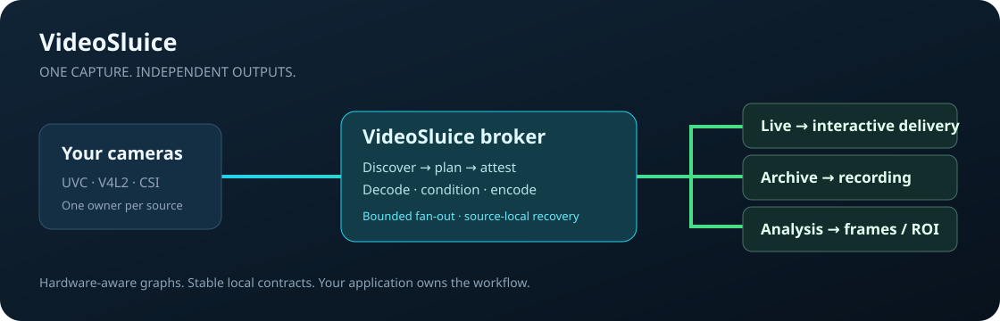

<p align="center"></p>

<h1 align="center">VideoSluice</h1>
<p align="center"><strong>Capture once. Feed every video workflow.</strong><br>A hardware-aware video broker for Linux edge applications.</p>
<p align="center"><a href="https://github.com/Josepavese/videosluice/actions/workflows/ci.yml"></a> <a href="LICENSE"></a></p>

Your live stream, recorder and vision pipeline need the same camera. Opening it
three times creates competing owners, redundant decoding and coupled failures.
**VideoSluice gives each physical source one capture graph**, then exposes live,
archive and analysis outputs with independent cadence and consumer backpressure.
Applications consume video; the broker owns capture, media engines and recovery.

## Why use it?

| Need | What VideoSluice does |
|---|---|
| Live video + recording + AI from one camera | Shares acquisition and negotiated processing; consumers do not reopen the camera |
| Use your board's accelerators honestly | Discovers and attests available components per decode, resize and encode stage |
| Keep recording independent of a slow client | Bounded fan-out and per-consumer backpressure isolate consumers |
| Analyze pixels without a second decoder | NV12 shared memory and authenticated frame/ROI SDK with source provenance |
| Switch modes without guessing readiness | Capability-bound routing transactions admit, verify and persist graph changes |
| Run more than one camera | Source-local workers, epochs and recovery prevent one failed source from canceling the others |
| Diagnose an edge deployment | Reports actual graph, quality, capabilities and resource/processing telemetry |

These are implemented architectural properties, **not a promised FPS increase,
zero-copy guarantee or universal board certification**. Workload, camera format,
SDK and driver determine performance. Frame transport authenticates local process
identity and provenance; application-level user authorization remains yours.

## Install without cloning or compiling

Linux amd64/arm64, Python 3.10+, curl and the system media libraries are required.
The installer downloads one host/variant release asset, verifies its SHA-256 and
complete payload manifest, and activates an immutable release in your PAL home.

```sh
curl -fsSL https://github.com/Josepavese/videosluice/releases/latest/download/install.sh -o /tmp/videosluice-install.sh
bash /tmp/videosluice-install.sh
rm /tmp/videosluice-install.sh
~/.local/bin/videosluice --help
```

For a pinned RDK X5 install, select a [published tag](https://github.com/Josepavese/videosluice/releases)
with `--version TAG --variant rdkx5`. That variant
requires the board's supported vendor media runtime. The installer does not
change kernels, drivers, services or application configuration. macOS and
Windows providers are not implemented.

The default home is `${XDG_DATA_HOME:-$HOME/.local/share}/videosluice`. Configs,
data, logs and backups survive upgrades; `current` selects an immutable release.
The command is linked into `~/.local/bin`, with an idempotent login-shell PATH
entry. `--home`, `--launcher-dir`, `--archive --sha256` and `--destination` support
isolated testing and managed installation. Existing processes require an
orchestrated restart after upgrade; the installer does not take camera ownership.

## From camera to consumer

Choose an [example](examples/) and adapt source selector, output endpoints and
runtime paths to your application. Examples are system-service profiles, not
a promise that the listed device nodes exist on your machine.

```sh
videosluice --discover-capabilities
videosluice --config /absolute/path/camera.json --check-config
videosluice --config /absolute/path/camera.json
```

Schema v3 defines named `sources` and `streams`; each stream binds a source and
explicitly selects `live`, `archive` or `analysis`. Presence is enablement. No
implicit camera, automatic role remapping or silent H264 fallback is added.
H265 is the default compressed policy; request H264 explicitly when needed.
Native passthrough is possible when source and requested processing permit it.
Software use is allowed only by explicit policy and is reported as software.

Consume compressed packets through [the wire protocol](PROTOCOL.md), and analysis
through the [Python SDK](sdk/python/) or public Go packages:

```sh
go get github.com/Josepavese/videosluice@latest
```

The broker handles frame references and geometry. Detectors, models, identities,
recording retention, signaling, user authorization and task supervision belong
to your application. The current causal frame plane uses the authenticated SDK;
the plain framed analysis socket is not qualified for native causal publication.
See [the endpoint limitation](docs/QUALIFICATION.md).

## Hardware-aware, application-independent

| Input | Adapter | Media engines |
|---|---|---|
| USB/UVC and generic V4L2 | V4L2 | Discovered GStreamer or supported native workers |
| RDK X5 USB/CSI | V4L2 or vendor HBN | Native SP/HBN/JPU/VPU workers, when attested |
| CSI stacks exposing libcamera | libcamera | Discovered compatible GStreamer components |

This describes adapter availability, not a tested board list. Missing hardware
fails closed under strict acceleration policies. Quality/tone conditioning,
source admission, geometric provenance, bounded source recovery and transactional
routing are product-owned. Physical USB reset and OS maintenance are not.

## Develop and integrate

Read [architecture](docs/ARCHITECTURE.md), [governance](docs/GOVERNANCE.md),
[verification](docs/VERIFICATION.md) and [product contract](PRODUCT.md).
`scripts/check.sh` is the local/CI gate. Build assets into an absolute temporary
directory with `scripts/build-release.sh`; never build into the source checkout.
Release assets contain executables, native helpers, Go/Python SDK sources,
examples, protocol docs, exact commit metadata and dependency notices.

Embedding applications translate their configuration into the product schema
and supervise the released broker. Application AI workflows remain outside this
product. See [qualification](docs/QUALIFICATION.md) and [naming research](docs/NAMING.md).

MIT licensed. Native system/vendor libraries retain their own terms; see
[third-party notices](THIRD_PARTY_NOTICES.md).
